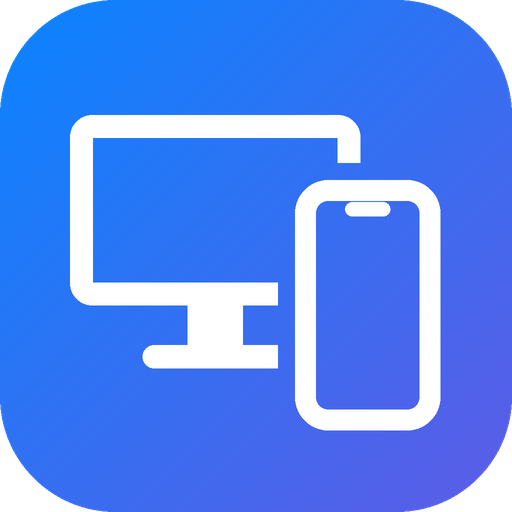

<p align="center"></p>

# Ayna Merkezi (iPhone + Mac)

*[Türkçe](README.tr.md)*

Mirror your iPhone on Windows and control it with the PC's mouse and keyboard. Connect to a Mac on the same
network (e.g. a Mac mini) with its code, and see and control its screen. The iPhone needs no extra hardware or
app; the Mac only runs this project's small menu-bar helper (**Ayna Ajan**) — no other remote-desktop software.

- **Main window (Ayna Merkezi / Settings):** turn iPhone on/off (when off, the receiver stops and its icon
  disappears), screen size, Mac connection, language (English / Türkçe), *Start with Windows*, *Refresh Zoom on
  connect* and **Check for updates / Install**. Opens from the notification-area icon, the right-click menu of
  the taskbar icons (*Settings*), or by starting the exe again.
- **Notification area:** the app's own icon (left click: Settings; right click: Settings, Check for updates,
  Quit). The icon of the bundled AirPlay receiver (uxplay-windows) is removed from there.
- **Taskbar icons on every monitor:** an iPhone icon left of Start and a Mac icon left of it. Windows open on the
  monitor of the icon you click. Right click: show/hide, **Disconnect**, **Settings**, **Check for updates**,
  *Start with Windows*, **Quit**.

## iPhone

- **Mirroring:** AirPlay (UxPlay receiver). The image appears in a borderless window with iPhone-like rounded
  corners right above the taskbar icon. **Ctrl + wheel** resizes it.
- **Control:** the PC's own Bluetooth connects to the iPhone as a **touch screen**; a click in the window is a
  finger tap at the same spot. No pointer, no AssistiveTouch.
- **Keyboard and clipboard:** typing goes to the iPhone; **Ctrl+V** types the Windows clipboard text.
- **Side buttons:** volume +/− on the left edge, power on the right edge (wakes / locks the iPhone).
- **Sending files:** drop files onto the iPhone window or icon; they go to iCloud Drive › *iPhone Ayna*
  (requires iCloud for Windows).

### Setup (once)

1. Download **`AynaMerkezi-Windows.zip`** from the [latest release](../../releases/latest), extract it and run
   `iPhoneAyna.exe` from the extracted folder. It needs the `bin\uxplay` folder next to it (the AirPlay receiver
   and the video decoder used for the Mac screen); `iPhoneAyna.exe` alone in the release is the update file.
2. **Mirroring:** same Wi-Fi; on the iPhone, Control Center → Screen Mirroring → **Ayna**.
3. **Control:** iPhone Settings → Bluetooth → pair the PC. Settings → Accessibility → **Zoom: On** (iOS only
   accepts external touch input while Zoom is on; triple-finger double tap to zoom out again). Choose the same
   hardware keyboard layout as on Windows.

| On the PC | On the iPhone |
| --- | --- |
| Left click / drag | Tap / swipe |
| Wheel | Scroll |
| Right click | Long press |
| Middle click | Home screen |
| Keyboard | Typing (Ctrl acts as Cmd) |
| Ctrl+V | Types the clipboard text |
| Esc | Hides the window |

## Mac

Same local network only; no server or internet needed.

**On the Mac (once):** install **Ayna Ajan** from `AynaAjan.dmg` (release assets), allow **Screen Recording** and
**Accessibility** in System Settings › Privacy & Security, and read the Mac's 9-digit **code** in the menu bar.

**On Windows:** click the **Mac icon**, type the code, **Connect**. The first time, both screens show a 6-digit
verification code: if they match, press **Allow** on the Mac and **Codes match** on Windows. After that the
devices prove their identity with a pairing key and connect automatically.

- **Mac window:** borderless, rounded, opens to the right of the Mac icon. **Ctrl → Command**, **Alt → Option**,
  Windows key → Control. Hiding the window keeps the connection; it reconnects by itself after sleep or network
  loss. If the Mac stops answering discovery, the last known address is tried directly.
- **Windows shortcuts on the Mac:** in Finder **Delete** moves to Trash, **Enter** opens, **F2** renames,
  **Backspace** goes back, **Ctrl+X / Ctrl+V** moves; in text **Home/End**, **Ctrl+←/→** word by word,
  **Ctrl+Y** redo, **Alt+F4** close window.
- **Drag and drop files** both ways: drop onto the Mac window to copy into the Finder folder under the pointer
  (or the Desktop); drag a file out of the Mac window to drop it anywhere on Windows. The file icon and name
  follow the pointer on both sides.
- **One pointer:** the Mac cursor isn't drawn into the video; the Windows cursor stays lag-free but takes the
  Mac cursor's shape.
- **Games (pointer lock):** when a game hides and captures the mouse, the Windows cursor is confined to the Mac
  window and raw mouse movement is sent as relative motion, so the camera turns freely. To release the mouse,
  **hold Ctrl for 10 seconds** (a countdown appears; nothing is sent to the game besides Ctrl). Click the window
  to capture again; Alt+Tab also releases it.
- **Mac icon right-click:** Mac screen size, *Show iPhone via Mac*, *Disconnect*, *Settings*, *Quit*.
- **iPhone via Mac (experimental):** uses the Mac's iPhone Mirroring from Windows. The Mac never shows it on its
  own screen: Ayna Ajan opens it on a hidden virtual display. Requires macOS 15 on Apple silicon, iOS 18, the
  same Apple Account, and iPhone Mirroring set to authenticate automatically.

**Security:** each session uses ephemeral ECDH P-256, HKDF-SHA256 and AES-256-GCM per direction; pairing needs
confirmation on both screens. Protocol details are at the top of `src/mac.rs` and
`mac-agent/Sources/main.swift`.

## Updates

Every push to `main` builds a signed release (`vN`). Windows and the Mac helper check for updates on their own
(or **Check for updates** / **Install**), verify the RSA-signed manifest and file hashes, and replace
themselves. Windows installs while no window is open; the Mac helper installs while nobody is connected.

## Language

Windows: Settings › Language (English / Türkçe); default follows the Windows display language. Mac: follows the
macOS language.

## Known limitations

- AirPlay compresses with H.264; not lossless. Audio is not forwarded from the Mac.
- The Bluetooth adapter must support the *peripheral* role.
- Logs: `%TEMP%\iPhoneAyna.log`, `%TEMP%\iPhoneAyna-uxplay.log`.

## Development

```
cargo build --release
copy target\release\iphone-ayna.exe iPhoneAyna.exe
```

Rust + `windows` crate (Windows app), Swift (`mac-agent/`, `build.sh` makes a universal .app and .dmg).
`tools/make_icon.py` regenerates the logo (`assets/`). `bin\` (UxPlay binaries) is not in the repository.
GitHub Actions builds both and publishes the release (`.github/workflows/build.yml`).

Built on: [abhishek-raj/windows-ble-hid](https://github.com/abhishek-raj/windows-ble-hid),
[sakx7/iOSBleDigitizer](https://github.com/sakx7/iOSBleDigitizer),
[leapbtw/uxplay-windows](https://github.com/leapbtw/uxplay-windows) (bundled in the release zip as `bin\uxplay`,
version 2.0.0.1736; UxPlay is GPL-3.0, see `bin\uxplay\LICENSE.rtf`).
