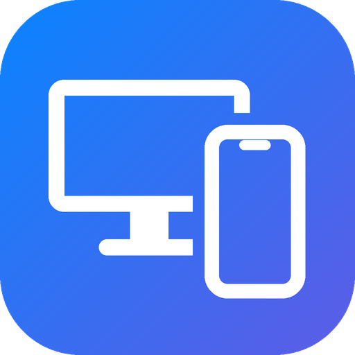

<p align="center"></p>

# Ayna Merkezi (iPhone + Mac)

*[English](README.md)*

iPhone ekranını Windows'a yansıtır ve bilgisayarın fare/klavyesiyle iPhone'u kontrol etmeyi sağlar.
Aynı ağdaki bir Mac'e (ör. Mac mini) koduyla bağlanıp ekranını görmeyi ve kontrol etmeyi sağlar.
iPhone için ek donanım ya da uygulama gerekmez; Mac'te yalnız bu projenin küçük menü çubuğu programı
(Ayna Ajan) çalışır, başka bir uzak masaüstü programı gerekmez.

- **Ana uygulama (Ayna Merkezi):** `iPhoneAyna.exe`'yi açınca gelen pencere. iPhone'u açıp kapatma
  (kapalıyken yansıtma alıcısı durur, ikon kalkar), ekran boyutu, Mac bağlantısı, "Windows ile başlat" ve
  "Bağlanınca Büyütme'yi yenile". Ayrıca görev çubuğu ikonlarının sağ tık menüsündeki **Ayna Merkezi**'nden
  ya da uygulama çalışırken exe'yi yeniden açarak gelir.
- **Görev çubuğu ikonları tüm monitörlerde:** Her görev çubuğunda Başlat'ın solunda iPhone ikonu, onun
  solunda Mac ikonu (ana uygulamadan kapatılabilir). Pencere, tıklanan ikonun bulunduğu monitörde açılır.

- **Yansıtma:** AirPlay (UxPlay alıcısı). Görüntü, görev çubuğundaki ikonun tam üstünde açılan çerçevesiz,
  köşeleri iPhone gibi yuvarlak (kenar yumuşatmalı) bir pencerede gösterilir. Pencere oranı iPhone'un bildirdiği
  kare geometrisinden alınır; siyah bar kalmaz. Boy **Ctrl + tekerlek** ile değişir ve hatırlanır.
- **Klavye ve pano:** Pencere odaktayken yazdıklarınız iPhone'a gider. **Ctrl+V**, Windows panosundaki metni
  iPhone'da imlecin olduğu yere yazar (Esc durdurur).
- **Kontrol:** PC'nin kendi Bluetooth'u iPhone'a **dokunmatik ekran** olarak bağlanır. Pencerede tıkladığınız
  nokta iPhone'da aynı noktaya parmakla dokunulmuş gibi işlenir. İmleç yok, AssistiveTouch gerekmez.
- **Görev çubuğu:** iPhone ekranının girişi Başlat düğmesinin solundaki telefon ikonu (pencerenin ayrı görev
  çubuğu düğmesi yok). Tıklayınca pencere açılır/gizlenir; sağ tık menüsünde "Ayna Merkezi", "Windows ile
  başlat" ve "Çıkış" var.

## Kullanım

1. [Son sürümden](../../releases/latest) **`AynaMerkezi-Windows.zip`**'i indirip açın ve `iPhoneAyna.exe`'yi açılan
   klasörden çalıştırın. Yanında `bin\uxplay` klasörü olmalı (AirPlay alıcısı ve Mac ekranının görüntü çözücüsü);
   sürümdeki tek başına `iPhoneAyna.exe` güncelleme dosyasıdır.
2. **Yansıtma:** iPhone ile PC aynı Wi-Fi'de olsun. iPhone'da Denetim Merkezi → Ekran Yansıtma → **Ayna**.
3. **Kontrol (bir kez):**
   - iPhone Ayarlar → Bluetooth → bilgisayarın adını (ör. `MASAUSTU-PC`) eşleyin. Daha önce eşlediyseniz önce
     **Bu Aygıtı Unut** deyip yeniden eşleyin (iPhone eski cihaz tanımını önbellekte tutar). Windows bir eşleşme
     onayı gösterirse kabul edin.
   - iPhone Ayarlar → Erişilebilirlik → **Büyütme: Açık**. iOS harici dokunmatik ekran girdisini yalnız Büyütme
     açıkken işler. Açınca ekran büyürse **üç parmakla çift dokunarak** normale döndürün; ayar açık kalır,
     ekranda hiçbir şey değişmez.
   - Görüntü gelmeden önce pencerede "Bluetooth: bağlı" yazıyorsa tıklama ve sürüklemeler iPhone'a gider.
   - Türkçe karakterlerin doğru yazılması için iPhone'da Ayarlar → Genel → Klavye → **Donanım Klavyesi**
     düzenini Windows'taki ile aynı seçin (ör. ikisi de Türkçe Q). Bağlı bir donanım klavyesi varken iOS ekran
     klavyesini gizler; yazı PC klavyesinden gelir.

| PC'de | iPhone'da |
| --- | --- |
| Sol tık | Dokunma |
| Basılı tutup sürükle | Parmakla kaydırma / sürükleme |
| Tekerlek | Sayfayı kaydırma |
| Sağ tık | Uzun basma |
| Orta tık (tekerleğe basma) | Ana ekran |
| Klavye | Yazı (Ctrl, iPhone'da Cmd olur: Ctrl+C/X/A/Z çalışır) |
| Ctrl+V | Windows panosundaki metni yazar |
| Ctrl + tekerlek | Pencere boyu |
| Esc | Pencereyi gizler (süren yapıştırmayı durdurur) |

Görüntü yokken sağ tık pencerenin kendi menüsünü (Gizle / Çıkış) açar.

### Kenar tuşları

Pencerenin sol kenarında **ses +/−**, sağ kenarında **güç (yan) tuşu** iPhone 16 Pro'daki yerlerinde durur. Tıklamak
iPhone'a Bluetooth üzerinden aynı tuşu gönderir. Tuşlar cihaz tanımına eklendiği için ilk seferde iPhone'da
**Bu Aygıtı Unut** deyip yeniden eşlemek gerekir.

Güç tuşu: görüntü yokken iPhone'u uyandırır, varken kilitler. iOS'un kilitleme için hangi HID kodunu kabul ettiği
modele ve sürüme göre değişiyor (standart "Power" kodu bazı iPhone'larda çalışmıyor). Uygulama birkaç yöntemi
sırayla dener: kilitlenen iPhone yansıtmayı kestiği için işe yarayan anlaşılır ve hatırlanır. Tutmazsa
"başka yöntem denenecek" bildirimi çıkar; tuşa yeniden basmak yeterli.

### Uyku, uyandırma ve Büyütme

- **Uyku engelleme:** Yansıtma sürerken uygulama 20 saniyede bir Bluetooth klavyesinden zararsız bir Shift
  vuruşu gönderir; iPhone kendiliğinden kilitlenip yansıtmayı kesmez.
- **Uyandırma:** Görüntü yokken (iPhone kilitli/ekranı kapalı) pencereye tıklamak iPhone'u uyandırır. Kilidi açıp
  Ekran Yansıtma'dan "Ayna"yı seçmek gerekir: iOS, ekran kapanınca yansıtmayı kendisi sonlandırır.
- **Büyütme'nin yenilenmesi:** iOS harici dokunmatik ekranı yalnız Büyütme açılırken bağlı olan cihazlara uygular.
  Bluetooth her (yeniden) bağlandığında uygulama Büyütme'yi klavye kısayoluyla (⌥⌘8) kapatıp açar. Bunun için
  iPhone'da **Ayarlar → Erişilebilirlik → Büyütme → Klavye Kısayolları** açık olmalı. Kapatmak için
  `HKCU\Software\iPhoneAyna\BuyutmeYenile` = 0.

## Dosya gönderme

Dosyayı (ya da klasörü) iPhone penceresine veya görev çubuğundaki telefon ikonuna sürükleyip bırakın.
Dosya iCloud Drive'daki **iPhone Ayna** klasörüne kopyalanır ve iPhone'da **Dosyalar > iCloud Drive > iPhone Ayna**
altında görünür. iPhone Bluetooth ile dosya kabul etmediği için yol bu. Önce "iCloud'a yükleniyor…", iCloud
yüklemeyi bitirince "iCloud'a yüklendi" bildirimi çıkar (iCloud'un ilk kurulumunda yükleme birkaç dakika sürebilir).

Bu bilgisayarda ücretsiz **iCloud for Windows** gerekir. Kurulu değilse ya da iCloud Drive açık değilse, ilk
bırakmada ne yapılacağı anlatılır ve Microsoft Store sayfası açılır. Kurulumdan sonra Apple kimliğiyle giriş
yapıp "iCloud Drive" kutusunu işaretlemek yeterli.

## Mac'e bağlanma

Şimdilik yalnız **aynı yerel ağ**: sunucu ya da internet gerekmez.

**Mac'te (bir kez):**
1. GitHub Actions'ın ürettiği `AynaAjan.dmg`'den **Ayna Ajan**'ı Uygulamalar'a sürükleyin. İmzasız olduğu için
   ilk açılışta sağ tık → **Aç** deyin.
2. İlk açılışta macOS iki izin sorar: **Ekran Kaydı** (görüntü) ve **Erişilebilirlik** (fare/klavye). Sistem
   Ayarları → Gizlilik ve Güvenlik'te Ayna Ajan'ı açın (gerekirse programı yeniden başlatın).
3. Menü çubuğundaki ekran simgesinde Mac'in **kodu** görünür (9 hane, bu Mac'e özel; tıklayınca kopyalanır).

**Windows'ta:** Görev çubuğundaki **Mac ikonuna** tıklayın; Mac penceresinde kodu yazıp **Bağlan**.
1. Mac yerel ağda kodla bulunur.
2. İlk seferde Mac'te "… bu Mac'e bağlanmak istiyor — Reddet / İzin ver" sorusu çıkar; Windows'taki Mac
   penceresinde de 6 haneli bir **doğrulama kodu** görünür. İki ekrandaki kod aynıysa Mac'te **İzin ver**'e,
   Windows'ta **Kodlar aynı**'ya basın (Mac'te varsayılan düğme Reddet). İki taraf da onaylamadan eşleşme
   kurulmaz: ağdaki başka bir cihaz kendini Mac ya da bu bilgisayar gibi gösteremez. İki taraf arasında bu
   bilgisayara özel bir eşleşme anahtarı oluşur.
3. Sonraki bağlantılarda soru çıkmaz: iki taraf kimliğini bu anahtarla kanıtlar. Uygulama açılışta eşleşilmiş
   Mac'e arka planda bağlanır; Mac ikonuna tıklayınca ekran hemen gelir.

**Mac penceresi:** Mac ikonunun üstünden sağa doğru açılan, çerçevesiz, köşeleri yuvarlak yatay bir pencere
(Mac ekranının oranında). Fare ve klavye Mac'e gider: **Ctrl → Command**, **Alt → Option**, Windows tuşu →
Control; tuşlar konuma göre eşlenir, iki tarafta aynı klavye düzeni (ör. Türkçe Q) seçili olmalı. Pencere
gizlenince (ikona yeniden tıklayınca) **bağlantı açık kalır**, yalnız görüntü durur; açınca kaldığı yerden
sürer. Bağlantı koparsa (Mac uykuya geçti, ağ gitti) kendiliğinden yeniden bağlanılır.

**Windows kısayolları Mac'te:** Windows'taki alışkanlık Mac'te aynı işi yapar.
- Finder'da (yazı alanı dışında): **Delete** çöpe atar, **Shift+Delete** kalıcı siler (Finder onay sorar),
  **Ctrl+D** çöpe atar, **Enter** açar, **F2** yeniden adlandırır, **Backspace** geri gider, **Alt+Enter**
  bilgi penceresi, **Alt+↑** üst klasör, **Ctrl+X** sonra **Ctrl+V** taşır.
- Yazı alanlarında: **Home/End** satır başı/sonu, **Ctrl+Home/End** metnin başı/sonu.
- Her yerde: **Ctrl+←/→** kelime atlar, **Ctrl+Backspace/Delete** kelime siler, **Ctrl+Y** yineler,
  **Ctrl+Tab** sekme değiştirir, **Alt+←/→** geri/ileri, **Alt+F4** ve **Ctrl+F4** pencereyi kapatır.

Odak öğrenilemezse yazı alanı sayılır (Delete yanlışlıkla dosya silmesin).

**Sürükle-bırak dosya:** Windows'tan dosya ya da klasörü Mac penceresine sürükleyip bırakın; bırakılan
noktadaki Finder penceresinin klasörüne (yoksa Mac Masaüstü'ne) kopyalanır. İlk seferde Mac "Ayna Ajan,
Finder'ı denetlemek istiyor" diye sorar (Otomasyon izni; verilmezse dosyalar Masaüstü'ne gider). Mac'te bir
dosyayı tutup Mac penceresinin dışına sürükleyin: dosya Windows'a alınır ve fare nereye bırakılırsa (Masaüstü,
Gezgin klasörü) oraya kopyalanır; fare dosya gelmeden bırakılırsa Windows Masaüstü'ne kaydedilir. Aktarım
şifreli oturumun içinden gider; büyük dosyalar sırasında görüntü ve fare akmaya devam eder. Windows'tan
sürüklerken dosyanın simgesi ve adı Mac'te (Mac ölçeğinde) imlecin altında görünür; Mac'ten çıkarırken
dosyalar inene dek simgesi ve adı Windows'ta imleci izler, sonra Windows'un sürükleme görüntüsü devralır.

**Tek imleç:** Mac imleci görüntüye çizilmez; Windows imleci gecikmesiz kalır ama Mac'teki şeklini alır
(yazı imleci, el, boyutlandırma okları).

**Oyunlarda fare (fare kilidi):** Mac'te bir oyun imleci gizleyip fareyi kilitleyince Windows imleci Mac
penceresine hapsedilir ve gizlenir; farenin ham hareketi Mac'e göreli gider, kamera serbestçe döner. Fareyi
bırakmak için **Ctrl'yi 10 saniye basılı tutun** (ekranda sayaç çıkar; oyuna Ctrl dışında hiçbir şey gitmez);
yeniden kilitlemek için pencereye tıklayın. Pencereden çıkınca (Alt+Tab) kilit kendiliğinden açılır.

**Mac ikonuna sağ tık:** Mac ekran boyutu (kaydırıcı), "iPhone'u Mac üzerinden göster", "Bağlantıyı kes",
"Ayarları aç" ve "Çık". iPhone ikonunun sağ tık menüsünde de "Bağlantıyı kes", "Ayarları aç",
"Güncellemeleri denetle" ve "Çık" var.

**Bildirim alanı:** Uygulamanın kendi logolu simgesi (sol tık: ayarlar; sağ tık: Ayarlar, Güncellemeleri denetle,
Çık). UxPlay'in (uxplay-windows) simgesi oradan kaldırılır.

**Dil ve güncelleme:** Ayna Merkezi'nde Dil (Türkçe / English) ve "Güncelleme · Denetle / Yükle". Mac'teki
Ayna Ajan, Mac'in diline göre Türkçe ya da İngilizce.

**iPhone'u Mac üzerinden (deneme):** Mac'teki iPhone Mirroring'i Windows'tan kullanır; Mac penceresinde Mac
ekranı yerine telefon görünür, fare ve klavye telefona gider (Cmd+1 ana ekran, Cmd+2 uygulama değiştirici,
Cmd+3 arama; Windows'ta Ctrl+1/2/3). Mac'in ekranında iPhone görüntüsü durmaz: Ayna Ajan görünmez bir sanal
ekran açar, iPhone Mirroring'i oraya koyar; kip kapanınca uygulamayı kapatıp sanal ekranı kaldırır.
Gerekenler: macOS 15 ve Apple çipli Mac, iOS 18, iki cihazda aynı Apple hesabı, iPhone Mac'in yakınında ve
kilitli. iPhone Mirroring ayarlarında kimlik doğrulama "otomatik" olmalı (yoksa açılışta görünmeyen ekranda
parola sorar). Sanal ekran macOS'un belgelenmemiş bir özelliğidir; açılamazsa Mac ekranına dönülür.

**Teknik:** Görüntü Mac'te ScreenCaptureKit ile yakalanıp VideoToolbox ile donanımda H.264'e kodlanır (en uzun
kenar 1920 piksel, 60 kare/sn'ye kadar, ~12 Mbit/sn), Windows'ta GStreamer ile donanımda çözülür (UxPlay'in
`bin\uxplay` paketindeki kütüphaneler). Bağlantı şifrelidir: her oturumda geçici ECDH P-256 anahtar değişimi,
HKDF-SHA256 ve yön başına AES-256-GCM. Ayrıntılı protokol `src/mac.rs` ve `mac-agent/Sources/main.swift`
başındadır.

Güvenilen bilgisayarlar ve "Bağlantılara izin ver" anahtarı Ayna Ajan menüsündedir.

## Bilinen sınırlar

- AirPlay H.264 ile sıkıştırır, tam kayıpsız görüntü mümkün değil. Gecikmeyi düşürmek için ses/görüntü eşitlemesi
  kapalı (`-vsync no`), 60 fps.
- iPhone yatay moddayken dokunma koordinatlarının yönü doğrulanmadı.
- Gönderilen dosyalar internet üzerinden iCloud'a gider; büyük dosyaların iPhone'da görünmesi yükleme hızına
  bağlıdır (ücretsiz iCloud kotası 5 GB).
- Windows 11'de iPhone'dan daha kısa Bluetooth bağlantı aralığı istenir; iPhone'un kabul edip etmediği
  `%TEMP%\iPhoneAyna.log` dosyasına yazılır.
- Yapıştırma metni tuş tuş yazar (saniyede ~30 karakter, en fazla 5000). Klavye düzeninde tek tuşla
  yazılamayan karakterler (ör. ölü tuş isteyen é) atlanır ve bildirimde sayısı yazılır.
- Bluetooth adaptörünün "çevre birimi (peripheral)" rolünü desteklemesi gerekir. Desteklemiyorsa pencerede yazar.
- UxPlay, Türkçe karakterli klasör yollarında çalışmıyor. Uygulama bunu 8.3 kısa yolla aşıyor; kısa adlar diskte
  kapalıysa klasörü `C:\iPhoneAyna` gibi bir yola taşıyın.
- Günlükler: `%TEMP%\iPhoneAyna.log` (uygulama: Bluetooth bağlantısı, dosya gönderimi) ve
  `%TEMP%\iPhoneAyna-uxplay.log` (yansıtma motoru; bir önceki çalıştırmanınki `.prev.log`). UxPlay gizli bir
  sözde konsolda çalışır, çıktısı satır satır ve anında günlüğe düşer.
- Mac bağlantısı yalnız aynı yerel ağda (aynı alt ağda) çalışır. Bilgisayarın IP adresi değişirse Mac'te
  "yeni bir adresten bağlanıyor" sorusu yeniden çıkar.
- Mac'te yalnız ana ekran gösterilir; ses aktarılmaz.
- Ayna Ajan imzasız (ad-hoc) olduğundan her yeni sürümde macOS Ekran Kaydı ve Erişilebilirlik izinlerini
  yeniden isteyebilir.
- iOS 27+ için alternatif (henüz uygulanmadı): Apple'ın geliştirici kanalı (CoreDevice) Bluetooth ve Büyütme
  olmadan dokunma iletebiliyor; bir kerelik Geliştirici Modu + USB eşleme gerektirir
  ([go-ios#849](https://github.com/danielpaulus/go-ios/pull/849)).

## Geliştirme

```
cargo build --release
copy target\release\iphone-ayna.exe iPhoneAyna.exe
```

Rust + `windows` crate. Dosyalar: `hub.rs` (Ayna Merkezi penceresi), `mac.rs` (Mac'i bulma, şifreli oturum,
girdi), `macview.rs` (Mac penceresi, kod ekranı, boyut penceresi), `gst.rs` (GStreamer ile H.264 çözme),
`crypto.rs` (CNG: ECDH, HKDF, AES-GCM), `mirror.rs` (iPhone penceresi, video gömme, girdi), `ble.rs` (HID over GATT), `hid.rs` (dokunmatik
ekran + klavye + tüketici rapor tanımı), `taskbar.rs` (tüm görev çubuklarında cihaz ikonları), `buttons.rs`
(kenar tuşları), `uxplay.rs` (AirPlay motoru), `transfer.rs` (iCloud Drive'a dosya gönderme), `toast.rs`
(bildirim balonu), `corners.rs` (yumuşak köşe katmanı).

Mac yardımcısı: `mac-agent/` (Swift, AppKit + Network; `build.sh` evrensel .app ve .dmg üretir). Her `main`
gönderiminde GitHub Actions Windows exe'sini ve Mac .dmg'sini derleyip artefakt olarak yükler
(`.github/workflows/build.yml`). `bin\` (UxPlay ikilileri) depoda değildir.

Yararlanılan açık kaynak çalışmalar:
[abhishek-raj/windows-ble-hid](https://github.com/abhishek-raj/windows-ble-hid) (WinRT ile HOGP),
[sakx7/iOSBleDigitizer](https://github.com/sakx7/iOSBleDigitizer) (AssistiveTouch'sız BLE dokunmatik ekran descriptor'u),
[leapbtw/uxplay-windows](https://github.com/leapbtw/uxplay-windows) (UxPlay Windows derlemesi).
